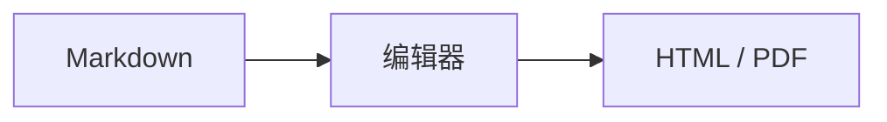

# GitHub Markdown 示例

> [!NOTE]
> `str` 和 `bytes` 都不可变。这里支持 **加粗**、[链接](https://github.com) 和列表。

> [!TIP]
> 始终使用 `python -m pip install xxx`，以安装到当前解释器。

> [!IMPORTANT]
> Python 的语法层级基于缩进。Tab 和空格不能混用。

> [!WARNING]
> 不要使用裸的 `except:`，它会吞掉 `KeyboardInterrupt` 和 `SystemExit`。

> [!CAUTION]
> 删除数据前检查路径，并保留备份。

## GFM 与脚注

| 特性 | 状态 |
| --- | --- |
| 表格 | 支持 |
| ~~删除线~~ | 支持 |

- [x] GitHub Alerts
- [x] 脚注[^note]
- [ ] 示例任务

Unicode 表情 :smile: :rocket:，颜色 `#0969DA`，H<sub>2</sub>O，x<sup>2</sup>，<ins>下划线</ins>，<kbd>Ctrl</kbd>。

@DwenChen、DwenChen/marktext#1 与 https://github.com/DwenChen/marktext。

[^note]: 脚注可以包含 **格式化文本** 和 [链接](https://github.com)。

<details>
<summary>展开更多内容</summary>

**折叠区块内部也支持 Markdown。**

- 第一项
- 第二项

</details>

## 数学与图形

行内公式 $`x^2 + y^2 = z^2`$。

```math
\sum_{i=1}^n i = \frac{n(n+1)}{2}
```



```geojson
{"type":"FeatureCollection","features":[{"type":"Feature","properties":{},"geometry":{"type":"Polygon","coordinates":[[[120,30],[122,30],[122,32],[120,32],[120,30]]]}}]}
```

```topojson
{"type":"Topology","transform":{"scale":[0.5,0.5],"translate":[120,30]},"objects":{"line":{"type":"LineString","arcs":[0]}},"arcs":[[[0,0],[2,2],[2,-1]]]}
```

```stl
solid pyramid
facet normal 0 0 1
outer loop
vertex 0 0 0
vertex 1 0 0
vertex 0 1 0
endloop
endfacet
facet normal 0 -1 0
outer loop
vertex 0 0 0
vertex 0 0 1
vertex 1 0 0
endloop
endfacet
endsolid pyramid
```

<!-- 注释在渲染视图中隐藏。 -->

代码块中的标记保持原样：

```markdown
> [!NOTE]
> 这里不会被转换成提示框。
```
